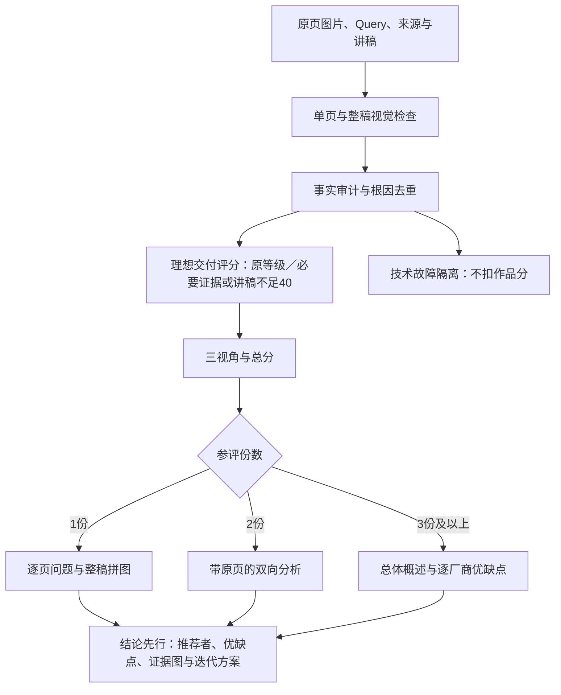

# PPT评测

按最终页面效果评测PPT，输出**页内细节、单页表达、整稿**三个视角的分数、问题位置、修改建议和HTML/JSON报告。

当前版本 **0.3.1-research**。默认按“距理想交付的差距”评分：必要证据或讲稿不足计40分，同根因只扣一次，评测器故障单列。原始事实审计保留在Debug；未经人工标定。

## 评测流程



N页默认进行N次主要单页视觉请求，另1次整稿检查与问题复核。原生对象只作可选辅助，不逐对象调用模型，也不要求模型复述制作零件的ID。某个判项无效，不会丢掉整页其他有效结果。

| 视角 | 检查重点 |
|---|---|
| 页内细节（8维） | 文字、事实、可读、裁切、图片、图表标注、来源、颜色辨识 |
| 单页表达（8维） | 主旨证据、布局、密度留白、层级、图文、配图、关系、协调 |
| 整稿（8维） | 任务、故事、取舍、口径、视觉系统、节奏、讲稿、收束 |

同题多份PPT默认先显示对比首页：结论、综合评分与推荐者，再解释三视角的优缺点和迭代方案。两份时做双向比较；三份及以上给总体概述，逐一说明每个厂商，不做两两比较；统一调整权重后同时重算各份分数。可切换查看每份的原页与问题。主报告左侧展示原页，右侧列出该页的维度评分、问题和改法，只展开有修改项的页面。整稿用页序拼图配叙事优缺点。主报告用百分制与文字等级说明单项评分；整稿末尾不重复展示修改区块，问题集中在逐页部分。24项评分和权重可展开调整，实时重算综合评分与推荐者；工程资料在独立Debug页。

事实审计不能凭缺参考判错；交付评分则把必要证据不足按40分计入。同一问题只在主归属维度扣分。最终摘要和建议随复核结果重建，原始模型意见单独保留。

## 分数怎么算

每条视觉规则按0—4级评判，换算为0、25、50、75、100分。每条规则先跨页平均，再在所属视角内按权重平均；三个视角默认各占三分之一，综合分保留一位小数。默认24条规则等权，可以在报告中统一调整所有参评作品的权重。

必要财务依据或讲稿缺失按40分计入，代表距离理想交付的差距，不代表事实已经证实错误；真正不适用的规则排除。相同根因只归属一个主扣维度。坏图、接口失败、模型漏判等评测器故障不转换成低分，严重故障未解决不宣称胜出。

## 安装与使用

将`ppt-evaluation/`目录复制到Agent的skills目录，调用`$ppt-evaluation`。需要Python 3.10+及Pillow：

```bash
python -m pip install Pillow
```

先用可信工具把PPTX/PDF渲染为有序PNG/JPEG；仅检查已有图片也可。记录渲染器和源页映射，实际渲染由调用者完成。

```bash
python scripts/prepare.py --images /path/pages --pptx /path/deck.pptx --page-map /path/page-map.json --output /path/run/manifest.json
# 通过环境变量提供DEEPSEEK_API_KEY，勿写入输入文件或提交仓库。
python scripts/evaluate.py --manifest /path/run/manifest.json --context /path/context.json --out /path/run/evaluation --save-trace
```

默认调用官方DeepSeek `deepseek-flash`；其他兼容服务需显式配置。模型服务会接收指定页面与上下文，运行前取得输入所有者授权。未配置API时，也可以由Agent按同一协议评审，明确标记评审来源。

默认最多12次调用，临时网络错误最多重试1次且占用预算。N页正常需N＋1次；大稿请明确调整`--max-calls`。预算不足时输出部分报告与评测器故障记录，不伪装完成。不自动安装Office、不自动切换付费服务、不修改原PPT。

完整说明见 [SKILL.md](SKILL.md)、[计分规则](references/scoring.md)、[输入输出协议](references/input-format.md)。

已有结果无需重新调用模型，可通过`ppt-evaluation/scripts/compare_report.py entries.json --out comparison.html`生成对比页。`entries.json`是含`label`、`result_file`和`report`路径的列表；批量入口`batch.py`在有两份以上有效结果时自动生成对比首页。

对比分析用`analyze_comparison.py entries.json --out 新目录`补一次带原页的自然语言分析，再用`compare_report.py entries.json --insights 分析目录/insights.json --out comparison.html`输出图文报告。每个entries元素包含`id`、`label`、`result_file`和`report`。分析API需要单独预算，模型不得修改程序分数。

## 验证与限制

v0.2.3修复模型在UNKNOWN/N/A判项中省略null评分字段时的中断；有分状态缺少评分仍单独隔离，不补分。

```bash
# 仓库中的tests用于维护者回归；安装包按SKILL.md执行。
```

测试覆盖错误目标的局部隔离、原始审计与交付评分分离、100%证据不足计40分、技术失败不扣作者分、事实同口径核对、去重、复核摘要更新、调用预算及本地模拟服务端到端路径。模拟服务测试不代表真实模型质量。实际样本与私有运行日志不收入公开包。

图像评测无法保证穷尽所有小字与事实；结构化来源是否完整、图片识读、主观美感与语义去重仍需复核。判项覆盖率不等于“全部事实已核验”。原生编辑性、alt text、动画或真实演讲表现不属于默认截图质量分。

v0.2从逐原生对象改为按页评测；旧v0.1数据不可直接混算，须保留旧报告并重新准备输入。旧`ppt-quality-check`可保留为本地兼容入口，不是安装依赖。

## 开源与反馈

原创程序和规则采用[MIT](LICENSE)。[来源索引](references/sources.md)保留参考项目与许可边界，不代表复制其实现或采用其现成总分公式。包中不含客户PPT、公司评测表、WorkBuddy内部文档或凭据。

公开源码与更新来源：[foxbitcoo/ppt-evaluation-skill](https://github.com/foxbitcoo/ppt-evaluation-skill)。首次安装可克隆仓库，再将`ppt-evaluation/`复制到Agent的skills目录；更新时在克隆目录执行`git pull --ff-only`，再替换已安装的Skill目录。不安装全局自动更新钩子。

问题可在[GitHub Issues](https://github.com/foxbitcoo/ppt-evaluation-skill/issues)反馈版本、最小复现和脱敏结果；不要上传私有PPT、完整提示词或密钥。安全问题见[SECURITY.md](SECURITY.md)。
